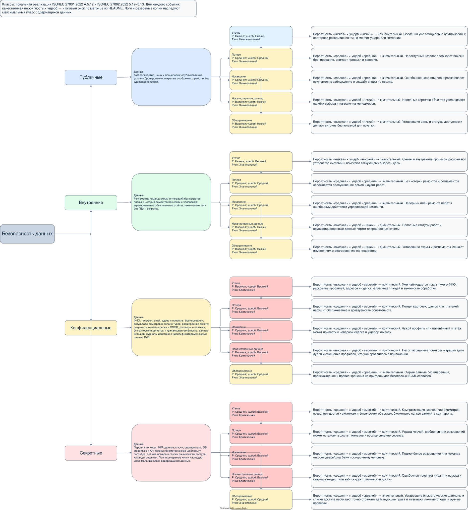

# Классификация и оценка данных

 . Четыре класса - **локальная шкала PropDevelopment**, построенная по принципам классификации и маркировки активов ISO/IEC 27001:2022, контроль A.5.12–A.5.13, и ISO/IEC 27002:2022, п. 5.12–5.13. Эти стандарты не предписывают именно четыре указанных названия классов.

Каждый риск рассчитан как **качественная вероятность × ущерб**. Вероятность учитывает архитектуру и известные факты кейса: "низкая" - нет известного проявления и мало доступных путей, "средняя" - реалистичный путь существует, "высокая" - проблема уже проявилась либо отсутствие контроля делает событие ожидаемым. Ущерб: "низкий" - локальный и обратимый, "средний" - нарушение сервиса или ощутимый ущерб, "высокий" - нарушение физической безопасности, прав людей или ключевых операций.

| Вероятность ↓ / ущерб → | Низкий | Средний | Высокий |
| --- | --- | --- | --- |
| Низкая | Незначительный | Незначительный | Значительный |
| Средняя | Незначительный | Значительный | Критический |
| Высокая | Значительный | Критический | Критический |

В каждом узле риска mindmap указаны вероятность, ущерб и итог, а в объяснении - формула и причина выбора. Один и тот же набор может получить более строгий класс после объединения: например, открытый адрес объекта вместе с квартирой и ФИО относится к конфиденциальным данным.

Перечень охватывает результаты осмотров и онлайн-туров, расширенную анкету и документы сделки, данные СМЭВ, бухгалтерские регистры и отчётность, данные аутентификации, журналы и резервные копии. Технический лог без ПДн и секретов относится к внутренним данным; журнал действий с идентификатором человека - к конфиденциальным. Лог, дамп или резервная копия **наследует самый строгий класс** содержащихся исходных данных, поэтому копия с ключом или хешем пароля является секретной.

Биометрические шаблоны указаны как секретные в модели целевого сервиса. Предложенная архитектура не передаёт их в PropDevelopment: они остаются под контролем партнёра. Списки номеров машин и команды открытия считаются секретными из-за последствий ошибочного или несанкционированного доступа.

Источники: [исходная C4-диаграмма](../Task3/PropDevelopment_original.drawio.xml), описание кейса; [ISO/IEC 27001](https://www.iso.org/standard/27001), [ISO/IEC 27002](https://www.iso.org/standard/75652.html).
